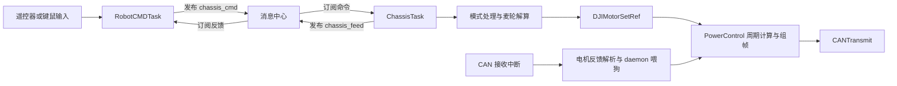

# 跃鹿 basic_framework 源码学习与本工程适配笔记

本文记录原框架学习与后续适配设计。当前已接入 FreeRTOS 和首个 BSP/任务监测模块，
实现见 `docs/freertos-integration.md`；电机第一阶段已接入 UART5 BSP、EMM 总线及四个实例，见 `docs/emm-motor-integration.md`；标准 X 型四全向轮正反解算、USB CDC v1及正常连续控制已接入，见 `docs/omni-chassis-kinematics.md` 和 `docs/lower-controller-handoff.md`；正式版已移除手动运动模块，核对记录见 `docs/chassis-calibration-record.md`。

2026-10-28 用户已确定：后续工程按照跃鹿框架的分层与实例组合方式编写。当前工程的具体开发约定记录在根目录 `AGENTS.md`；本笔记中尚未实施的目录、接口和适配建议仍为待开发内容。

## 1. 阅读基准

- 上游仓库：<https://github.com/HNUYueLuRM/basic_framework>
- 本次检出的 HEAD：`c1394f37123a36f58a02cf3ddc60db69725bbd35`，提交日期 `2026-03-17`，提交说明 `doc: typo`。
- 下文“原框架”指这个提交；“适配建议”是针对当前 ROS 底盘下位机的设计建议，并非上游已有功能。
- 已阅读 README、架构开发指南，以及启动、任务、命令、底盘、电机、CAN/UART/USB、消息中心、daemon、板间通信的相关实现。

## 2. 核心思想：分层与实例组合

| 层 | 原框架职责 | 本工程对应职责 |
| --- | --- | --- |
| HAL / CubeMX | 时钟、外设、IRQ、DMA 等初始化与基础驱动 | 保留现有 Core、Drivers、USB_DEVICE 和 `.ioc` |
| bsp | 封装 CAN、UART、USB、PWM、GPIO、DWT 等服务 | 提供收发、PWM、计时等基础服务 |
| modules | 设备协议、PID、传感器、消息中心、离线监测 | 电机驱动、编码器、IMU、ROS 通信协议等 |
| application | 命令生成、机构状态、底盘运动学、应用协调 | ROS 命令仲裁、底盘解算、状态反馈 |

依赖自上而下：application 使用 modules，modules 使用 bsp，bsp 使用 HAL。BSP 不包含底盘应用头文件。

原框架用 C 结构体表达对象：

1. 配置结构体描述总线、ID、回调、PID、反馈来源与方向等参数。
2. `XXXRegister()` / `XXXInit()` 创建并返回实例指针。
3. 后续 API 通过实例指针区分具体设备。
4. 一个模块组合它需要的其他实例，例如电机组合 CAN、PID 和 daemon。
5. CAN 等 BSP 保存模块回调及 `void *id`；收到消息后，模块从 `id` 恢复拥有者实例。

这让同一种设备可以创建多个实例，也避免 BSP 直接认识某个上层设备。并非每个 BSP 都采用完全一致的实例形式：例如此版本 USB 为单例封装。

参考源码：[CAN 实例与接口](https://github.com/HNUYueLuRM/basic_framework/blob/c1394f37123a36f58a02cf3ddc60db69725bbd35/bsp/can/bsp_can.h)、[DJI 电机实例](https://github.com/HNUYueLuRM/basic_framework/blob/c1394f37123a36f58a02cf3ddc60db69725bbd35/modules/motor/DJImotor/dji_motor.h)。

## 3. 实际启动与任务链

```text
main
  HAL / 时钟 / MX_* 外设初始化
  RobotInit
    BSPInit：DWT 与日志
    RobotCMDInit：注册输入模块及命令/反馈话题
    ChassisInit：构造电机及底盘依赖，注册命令/反馈话题
    OSTaskInit：创建周期任务
  MX_FREERTOS_Init
  osKernelStart
    默认任务初始化 USB_DEVICE 后退出
```

默认配置为 `ONE_BOARD`。`RobotTask()` 顺序调用 `RobotCMDTask()`、`ChassisTask()`；云台和发射应用的初始化、任务调用目前被注释。目录中存在模块，不代表该模块正在运行。

| 任务 | 实际主要调用 | 源码每轮处理后的延时 |
| --- | --- | --- |
| Robot | RobotCMDTask → ChassisTask | `osDelay(5)` |
| Motor | DJIMotorControl → PowerControl → LKMotorControl | `osDelay(1)` |
| Daemon | DaemonTask、BuzzerTask | `osDelay(10)` |
| INS | 初始化 IMU，循环姿态解算并发送视觉数据 | `osDelay(1)` |
| UI | 裁判系统 UI | `osDelay(1)`，内部也有挂起 |

这些是延时参数，不能直接认定为实测精确的 200 Hz / 1 kHz；还需考虑 tick 配置、处理耗时及任务抢占。

当前用户工程已接入 FreeRTOS / CMSIS v1；默认任务和独立状态监测任务已进入构建。
上游的其他任务需要随对应业务增量接入。

参考源码：[robot.c](https://github.com/HNUYueLuRM/basic_framework/blob/c1394f37123a36f58a02cf3ddc60db69725bbd35/application/robot.c)、[robot_task.h](https://github.com/HNUYueLuRM/basic_framework/blob/c1394f37123a36f58a02cf3ddc60db69725bbd35/application/robot_task.h)。

## 4. 命令与底盘的真实数据流



需要区分两条电机控制路径：

- 普通 DJI 模块：`DJIMotorInit → DJIMotorControl`。
- 本版本底盘实际使用：`PowerControlInit → PowerControl`，与普通 DJI 模块复用了实例类型及部分设置接口，但持有独立的实例表和 CAN 发送分组。

因此，不能看到 `DJIMotorSetRef()` 就认定由 `DJIMotorControl()` 完成该底盘的输出。两套模块若占用同一总线、同一个组帧发送 ID，还需要统一发送所有权，避免互相覆盖。

`ChassisTask()` 还绑定了云台偏角、裁判系统功率限制和超级电容。`EstimateSpeed()` 当前为空，反馈结构里的底盘实际速度字段也没有实现。该示例尚不具备完整的 ROS 轮速反馈与里程计链路。

参考源码：[chassis.c](https://github.com/HNUYueLuRM/basic_framework/blob/c1394f37123a36f58a02cf3ddc60db69725bbd35/application/chassis/chassis.c)、[motor_task.c](https://github.com/HNUYueLuRM/basic_framework/blob/c1394f37123a36f58a02cf3ddc60db69725bbd35/modules/motor/motor_task.c)、[power_control.c](https://github.com/HNUYueLuRM/basic_framework/blob/c1394f37123a36f58a02cf3ddc60db69725bbd35/modules/motor/power_control.c)。

## 5. 消息、通信与执行上下文

### 消息中心

`PubRegister()`、`SubRegister()` 按名称和数据长度建立话题。发布时把数据复制到各订阅者缓存，应用之间不需要互相包含头文件。

本版本 `QUEUE_SIZE=1`，满时覆盖旧消息，适合传递最新速度目标。实现没有跨任务同步保护，不能直接当作线程安全消息总线；单次动作事件也不宜使用覆盖语义。没有新消息时，订阅读取返回 0，调用方保留的旧命令不会自动失效。

适配建议：速度命令携带接收时间和有效期；不同任务之间使用有明确同步保证的快照或 RTOS 队列。停止条件直接参与最终输出仲裁。

### 通信 BSP

- CAN 收到数据后在 HAL 中断回调路径查找实例、复制报文并调用模块回调。此版本发送会等待邮箱空闲并检查超时，并未采用发送队列。
- UART 使用 ReceiveToIdle DMA；模块回调没有接收长度参数。IDLE/DMA 事件不等于一条完整的协议消息。
- USB 使用修改过的 CDC 接收、发送完成回调。直接复用时必须检查与本工程 CubeMX 生成文件的接入点，并处理发送 busy 和缓冲区生命周期。
- `bsp_tools` 提供回调任务工具，但 CAN/UART 的上述处理并不会自动搬到任务上下文。
- `can_comm` 提供固定长度负载的分片/重组和 CRC8。`CANCommGet()` 返回缓存数据，不能据此判断收到新包或链路在线。

适配建议：ROS 通信的收包与协议解析解耦，处理分片、粘包、错误校验、队列溢出、掉线和恢复。只有合法完整帧才能刷新命令有效期。原 `master_machine` 实现的是视觉协议，不能直接认为已支持 `/cmd_vel`。

### 离线监测

daemon 按任务扫描递减计数，设备收到反馈后重载计数。这个机制可以保留，但本版本存在初始化计数被覆盖的行为；离线回调可能重复执行。DJI 电机离线回调主要记录日志，不能由此推断电机一定已失能。

适配建议：将上位机命令超时、电机反馈超时和实际停止输出连接起来，并明确重新使能条件。

参考源码：[消息中心](https://github.com/HNUYueLuRM/basic_framework/blob/c1394f37123a36f58a02cf3ddc60db69725bbd35/modules/message_center/message_center.c)、[UART BSP](https://github.com/HNUYueLuRM/basic_framework/blob/c1394f37123a36f58a02cf3ddc60db69725bbd35/bsp/usart/bsp_usart.c)、[daemon](https://github.com/HNUYueLuRM/basic_framework/blob/c1394f37123a36f58a02cf3ddc60db69725bbd35/modules/daemon/daemon.c)。

## 6. “方便换模块”还需要补充的边界

上游的实例组合方式值得沿用，但原底盘直接持有 `DJIMotorInstance *`，调用 `DJIMotorSetRef()` 等具体接口，并在初始化时填写 HAL 句柄。仅复制目录不能保证更换任意电机时底盘应用无需修改。

本工程后续建议建立以下契约，具体接口名称在搭建时确定：

| 可替换部分 | 对应用保持稳定的契约 | 变化主要落点 |
| --- | --- | --- |
| 电机/驱动器 | 设置轮轴速度、停止、获取带时间戳和有效性的反馈 | 电机适配模块及板级组装 |
| USB / UART | 输入字节流、发送结果、连接/错误状态 | 通信 BSP 及板级绑定 |
| 上位机协议 | 解析为统一底盘命令，序列化统一反馈 | 协议模块 |
| 差速 / 麦轮等底盘 | 输入底盘速度，输出各轮速度；实测轮速反算底盘速度 | 运动学实现与几何配置 |
| 编码器 / IMU | 统一单位、时间戳、在线状态 | 传感器模块及板级绑定 |
| 裸机 / RTOS | 显式的 Init 和周期更新入口 | 系统调度入口 |

其中轮轴速度需与电机转子速度明确区分，减速比和方向在边界转换。建议应用层统一使用 m、s、rad：`vx/vy` 为 m/s，`wz` 为 rad/s，轮轴速度为 rad/s；底盘坐标采用 ROS 常用的 x 前、y 左、z 上。原示例包含毫米几何参数、度制角速度以及不同电机路径的 RPM 转换，不直接照搬其数字与符号。

建议集中一个板级组装位置保存 HAL 句柄、引脚、设备 ID、轮序、方向、减速比及底盘几何参数。板级组装负责创建实例和注入依赖，通用底盘逻辑不直接操作 HAL。

## 7. 本工程后续搭建范围与顺序

建议在现有 CubeMX 工程外增量加入以下自有目录，名称与跃鹿框架保持接近：

```text
board/                     板级资源映射和实例组装
bsp/                       通信、GPIO/PWM、计时等外设服务
modules/
  motor/                   统一电机接口及具体驱动适配
  algorithm/               PID、滤波等
  ros_comm/                上位机通信协议
  message_center/          应用命令/反馈交换
  daemon/                  在线状态管理
application/
  robot.c/.h               初始化和更新编排
  robot_def.h              应用消息及配置契约
  cmd/                     命令检查、仲裁、超时处理
  chassis/                 底盘模式、运动学及反馈
system/                    任务或裸机周期调度
```

这是整体设计，实际按需求加入组件：已接入 board、LED / UART BSP、任务监测和 EMM 电机模块及 system 任务；application 已加入 robot 编排、底盘正反解算及USB连续控制，正式接口见 `docs/lower-controller-handoff.md`；ROS节点和桥接由上位机负责人负责。不导入无关的云台、发射、裁判系统等模块。

推荐实施顺序：

1. 保留现有芯片、构建和 CubeMX 文件边界，确定自有入口及目录。
2. 固定命令、反馈、电机接口的单位、有效期和执行上下文。
3. 接入一路通信 BSP 和协议模块，验证收发及命令超时。
4. 按真实驱动器实现一个电机实例，验证反馈、方向及停止路径。
5. 接入底盘运动学和轮速闭环，完成命令到输出再到反馈的完整链路。
6. 根据实际复杂度接入周期任务、其他设备和更多底盘适配。

已确定电机为四个张大头 42 步进电机，使用 EMM V5.0 驱动器（用户已纠正原 V4.2 信息），通过 TTL 共用 UART5；底盘为四轮全向、X 型 45° 对称安装。ROS 2 上位机通过 USB CDC 连接 STM32，用户指定前后及左右轮中心间距均先按 240 mm 设计，实测后更新板级参数。

### 已确认的电机方案（2026-10-28）

- 数量与用途：四个张大头 42 步进电机，作为四轮底盘的驱动电机。
- 驱动器版本：张大头 EMM V5.0（用户已纠正原 V4.2 信息）；实现前按该版本说明书核对命令、应答与多机通信规则。
- 底盘类型：四轮全向轮底盘，X 型、45° 安装。已确认电机地址映射为：1=左前、2=右前、3=右后、4=左后；正转方向留在板级配置中确认。
- 电机通信：TTL 多机总线，使用 UART5，波特率 115200，驱动协议固定末尾校验字为 `0x6B`；地址为 1=左前、2=右前、3=右后、4=左后。`0x6B` 是协议字段，不是 UART 奇偶校验设置。
- 上位机通信：ROS 2，通过 USB CDC 连接 STM32；自定义协议及 ROS 2 桥接节点为当前建议方案，尚未实现。
- 机械参数：轮子直径 75 mm，半径 0.0375 m，无减速机构，电机轴与轮轴传动比为 1:1。用户指定前后及左右轮中心间距均暂定为 240 mm（0.240 m），尚非实测值；以几何中心为底盘原点、x 向前、y 向左，四轮中心坐标分别为左前 (+0.120, +0.120) m、右前 (+0.120, -0.120) m、右后 (-0.120, -0.120) m、左后 (-0.120, +0.120) m。尺寸后续集中放入板级配置，按实测修改。
- 待核实：前后及左右轮中心间距的实测值、俯视安装方向、各轮正转符号、驱动器多机实际接线及运行模式。电机方向通过单轮测试标定。
- 当前配置核对：UART5 已生成为 PC12/TX、PD2/RX，115200、8N1，无硬件流控；用户已加入 RX 循环 DMA、TX 普通 DMA 及对应中断（优先级 5），并已接入 EMM 电机任务。USB 已配置 CDC（PA11/DM、PA12/DP），但接收回调尚未接入应用协议。旧固件上板已收到带功能码的实物回包，暴露出旧协议格式不匹配；修正版已构建和测试，用户已烧录并确认四轮反馈正常；重复停止的后续修复仍待上板验证。

后续软件设计采用一个共享串口总线实例和四个独立电机实例。总线拥有唯一接收入口及发送调度，电机实例保存设备地址、安装方向、目标速度、反馈与在线状态。不能按“一台电机独占一个 UART”的方式重复注册同一外设。

协议确认后，由总线按地址分发响应；对响应帧无地址或有特殊应答规则的协议，按其实际规则串行组织请求与响应，避免多个电机同时回包。多轮同步启动仅在确认协议支持后接入，不预设广播/同步命令。

建议的控制链为 `底盘速度命令 → 运动学解算 → 四个轮轴速度 → 四个电机实例 → 共享串口总线`。应用层使用统一轮轴速度单位，由电机适配模块转换为驱动器要求的单位。速度反馈必须来自实际支持的读取命令，不能把目标速度当成实测速度。

若驱动器内置速度闭环，先使用其速度模式；是否需要 MCU 侧附加控制环，由反馈能力和实测需求决定。全向轮运动学按已确认的 X 型、45° 安装建立，并结合各轮相对底盘中心的位置与驱动方向核对旋转项及符号；轮序、安装角度、轮径及传动比应配置化。全向轮的驱动方向投影与麦克纳姆轮辊子约束不同，不能仅凭同为 45° 就直接套用上游麦克纳姆轮公式。

### EMM V4.x 多机串口资料核对（2026-10-28，历史资料，不适用当前实物）

**实物纠正：** UART5 已实际收到 `01 36 00 00 00 00 00 6B`、`01 3A 82 6B` 和 `01 00 EE 6B`。旧模块预期的 6 字节位置响应及 3 字节状态响应与实物不符，也有命令被拒绝；本节旧资料不能再作为当前协议实现依据。现已改为带功能码协议：位置 8 字节、状态/写应答 4 字节、立即停止 `00 FE 98 00 6B`、失能 `00 F3 AB 00 00 6B`，使能与堵转由 `0x3A` 同帧解析。具体证据、验证状态和接口见 `docs/emm-motor-integration.md`。用户现已更正型号为 EMM V5.0，并确认修正后的四轮反馈正常。最新发现已失能状态重复发送 FE 会得到 E2，修正重复停止策略及上板待验证项见集成记录。

来源：[Macrobase-tech/Emm42 公开镜像中的 V4.x 说明书](https://github.com/Macrobase-tech/Emm42/blob/main/Datasheet/Emm_V4.x%E6%AD%A5%E8%BF%9B%E9%97%AD%E7%8E%AF%E9%A9%B1%E5%8A%A8%E5%99%A8%E8%AF%B4%E6%98%8E%E4%B9%A6Rev1.0.pdf)。已查看正文第 19 页 TTL 多机接线图，以及第 27、33、35—41 页参数和串口协议。该资料属于 V4.x 通用说明；实际 V4.2 硬件若有独立修订说明，按其修订核对。

- 原 TTL 多机图将 MCU TX 接至所有驱动 RX、各驱动 TX 接至 MCU RX，并共地；驱动板的 3V3 不接。该接法针对说明书所述 EMM 驱动，不能泛化成任意普通 UART TX 输出都可以并联。RS232、RS485 套餐应使用各自接线图与电平转换，不能直接套 TTL 图。
- 菜单设置：`Mode=CR_UART`；`UartBaud` 四台一致且与 MCU 一致，默认 38400，可选 115200；`UartAddr` 分别设置为 1、2、3、4；`DatCheck=0x6B` 时使用固定末尾校验字。
- 地址范围 1—247，地址 0 是广播。说明书规定广播命令仅地址 1 的电机回复，其他地址不回复。
- 速度命令为 6 字节：`地址 F6 方向与速度高字节 速度低字节 加速度 校验`。方向占最高半字节，顺时针为 0、逆时针为 1；速度为档位 0—1279，不能直接当作 RPM。
- 固定校验模式下，`01 F6 00 32 00 6B` 表示地址 1（左前）、顺时针、速度档位 50、加速度档位 0；`02 F6 10 32 00 6B` 表示地址 2（右前）、逆时针、同样的速度/加速度档位。地址 3 为右后，地址 4 为左后，方向以实车轮子正转标定结果为准。
- `00 F6 00 00 FF 6B` 是广播零速度且不使用曲线加减速，按说明书用于立即停止；广播会让所有设备执行同一参数，不能代替四轮独立速度解算。
- 典型确认回复为 `地址 02 校验`，错误回复为 `地址 EE 校验`；读取参数命令返回对应长度的数据。共享总线应一次组织一个请求/响应事务，收到预期帧或超时后再处理下一个。
- 读取实时位置可用 `地址 36 6B`，返回地址、4 字节有符号位置、校验字。运动反馈按实测时间差计算，不能将设定速度冒充反馈。
- V4.x 说明书中的 `FF` 功能码用于存储/清除上电自动速度运行参数。本次资料未列出 V5 式多机同步触发，不能混用 V5 的同步指令。

## 8. 学习阶段基线与复用约束

- 接入前的基线命令：`cmake --build --preset Debug`，执行成功。
- 基线链接结果：FLASH 33,828 B，RAM 9,536 B；这只验证原工程可构建。
- 最初学习阶段未修改固件源码、外设配置或 CMake 接入。之后已完成 FreeRTOS 与 PB2 状态灯接入及编译验证，当前结果见 `docs/freertos-integration.md`；用户已自行烧录并确认 LED 正常闪烁。电机实测回包与协议修正见 `docs/emm-motor-integration.md`；用户已确认四轮反馈正常；重复停止的后续修复及 ROS 业务链路仍待上板验证。
- 上游采用 MIT License，版权为 `Copyright (c) 2022 NeoZng`；后续复用实质代码时保留对应许可和版权声明。
